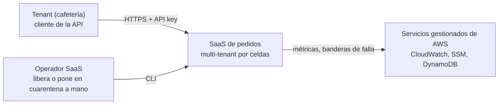
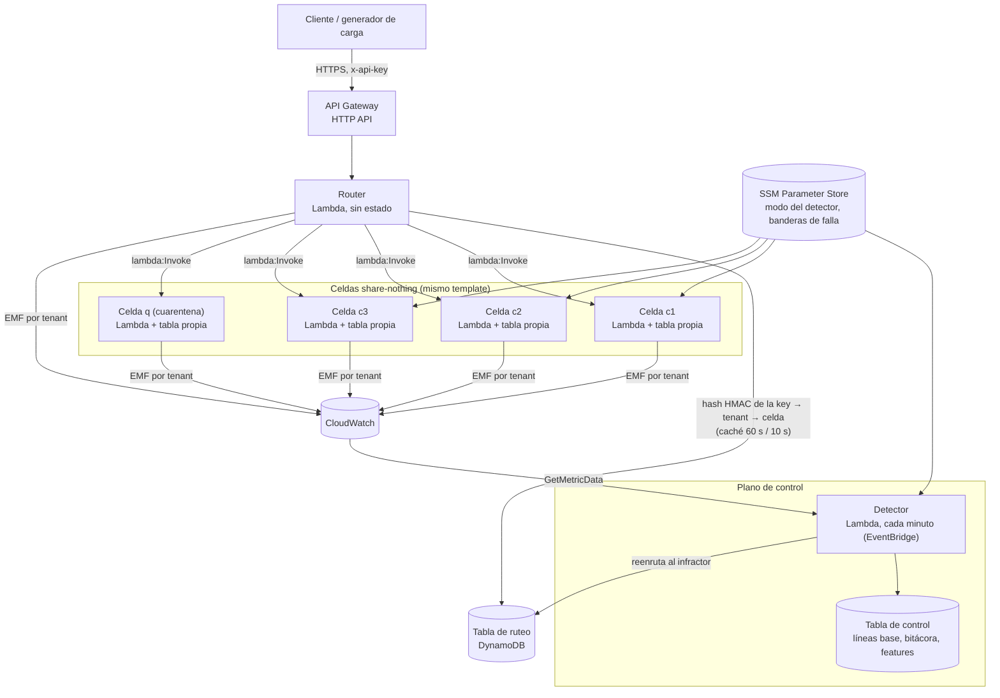
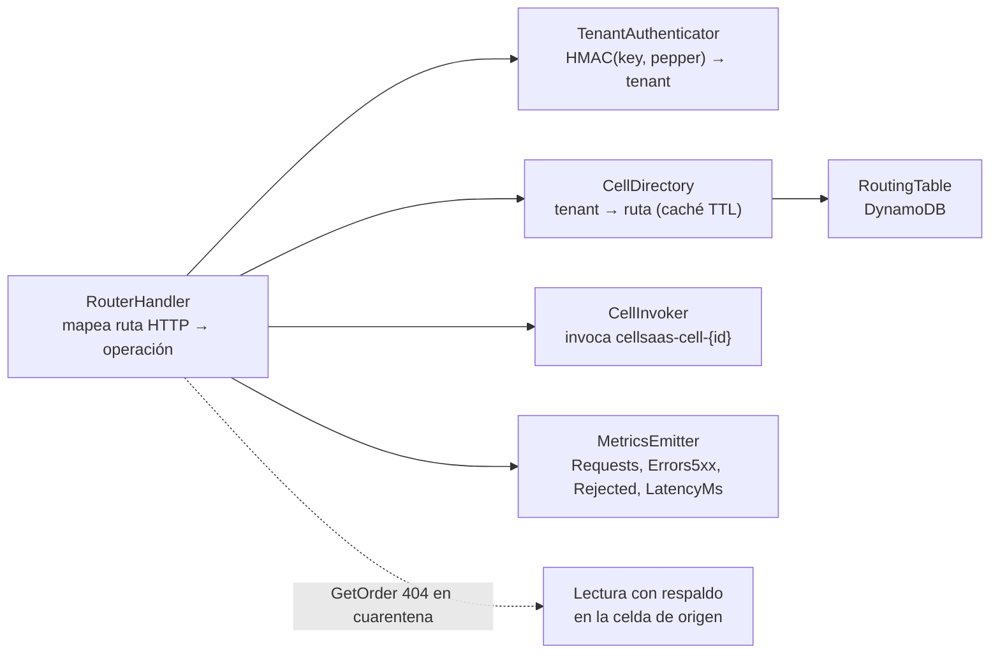
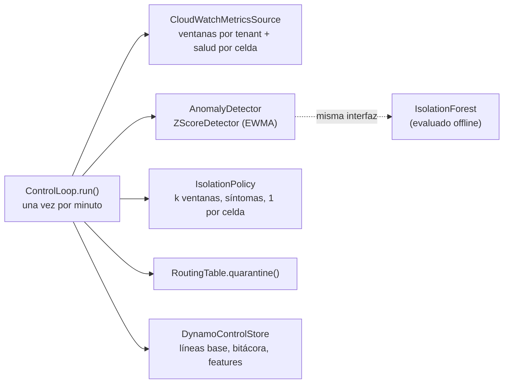

# Vistas C4

## Nivel 1 · Contexto

## Nivel 2 · Contenedores

La configuración **pool** usa el mismo template de celda con 4 veces la capacidad, detrás del mismo router: entre P, C y C+IA solo cambia la tabla de ruteo y el modo del detector ([ADR-002](../adr/ADR-002-misma-base-de-codigo.md)).

## Nivel 3 · Componentes del router

## Nivel 3 · Componentes del plano de control

